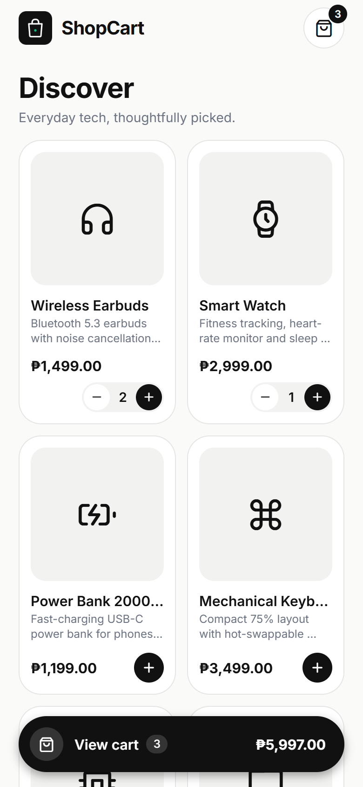

# ShopCart: React Native Add to Cart

A minimalist Add to Cart app built with **React Native (Expo)**, **React Hooks**, and **NativeWind** (Tailwind CSS for React Native).

📦 **Android APK:** see the [latest release](../../releases/latest)

<p>
  
  &nbsp;
  
</p>

## Features

| Requirement | Where |
|---|---|
| 6 static products (`productName`, `description`, `price`) | `src/data/products.js` |
| Add to cart / remove one unit / remove whole line | `src/utils/cart.js`, `ProductCard.js`, `CartItem.js` |
| Real-time item count (header badge, View cart bar, cart sheet) | `itemCount` in `src/context/CartContext.js` |
| Cart list with product name + price, in a **bottom-sheet modal** | `src/components/CartModal.js` |
| Real-time total | `total` (`useMemo`) |
| Voucher `discount10` gives 10% off (case-insensitive) | `applyVoucher`, `discountedTotal` |
| Tailwind styling with brand tokens (`ink`, `canvas`, `accent`…) | `className` via NativeWind, `tailwind.config.js` |
| Splash screen, app icon, logo | `app.json` (`expo-splash-screen`), `assets/brand/logo.svg` |

## Hooks used

| Hook | Used for |
|---|---|
| `useState` | `cart`, `voucherApplied`, `voucherError` (context); `cartOpen` (App); voucher text (CartModal) |
| `useEffect` | Clears the voucher when the cart empties; hides the splash once fonts load; animates the cart sheet in |
| `useMemo` | Derived `itemCount`, `total`, `discountedTotal`, and the context value |
| `useCallback` | Stable `addToCart` / `removeFromCart` / voucher handlers, `openCart` / `closeCart` |
| `useRef` | Holds the `Animated.Value` for the sheet slide-up |
| `useContext` | Shares cart state app-wide via `CartContext` |
| Custom hook `useCart()` | Wraps `useContext` and throws if used outside `<CartProvider>` |
| `useFonts` (expo-font) | Loads Inter before the splash screen hides |

## Project structure

```
App.js                     # fonts + splash, CartProvider, product grid, cart modal
assets/brand/logo.svg      # logo source (PNGs rendered by scripts/render-brand.sh)
src/
  data/products.js         # static catalog
  utils/cart.js            # pure helpers: addItem, removeItem, cartTotal, applyDiscount…
  context/CartContext.js   # CartProvider: state + derived values
  hooks/useCart.js         # custom hook
  theme/colors.js          # brand palette (used by tailwind.config.js and icon colors)
  components/
    Header.js              # logo, wordmark, cart button + badge
    ProductCard.js         # grid card with add button / qty stepper
    QtyStepper.js          # − qty + control
    ViewCartBar.js         # floating "View cart" pill
    CartModal.js           # bottom-sheet cart: items, voucher, totals
    CartItem.js            # cart line
scripts/test-cart.mjs      # logic checks (npm test)
```

## Run locally

```bash
npm install
npx expo start          # scan the QR with Expo Go, or press "a" for an Android emulator
npm test                # cart logic checks
```

## Build the APK

```bash
npx expo prebuild -p android
cd android && ./gradlew assembleRelease
# → android/app/build/outputs/apk/release/app-release.apk
```

On Windows, build from a short path (e.g. `C:\sc\app`), because the native C++ build exceeds the 260-character path limit otherwise.
Or build in the cloud: `npx eas-cli build -p android --profile preview` (with `"buildType": "apk"` in `eas.json`).
